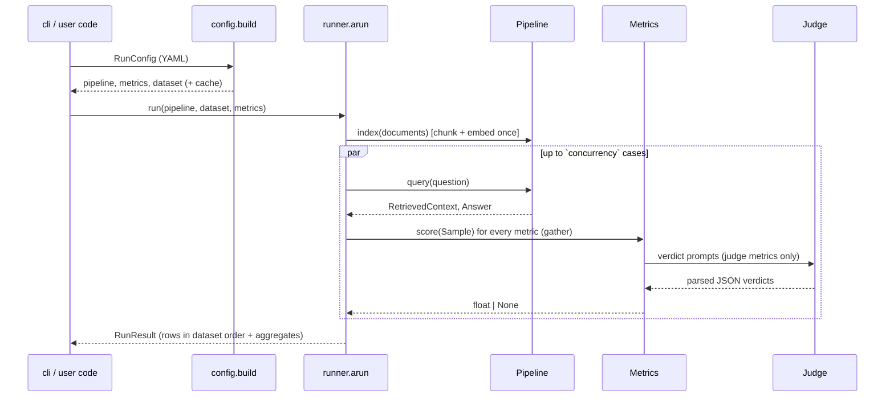

# Architecture

This document explains how ragcheck is put together and why. It is aimed at contributors
and at anyone who wants to plug their own components in.

## Design goals

1. **Reproducible by default.** Every result must be regenerable bit-for-bit offline. That is
   why the hashing embedder, extractive generator and deterministic judge exist, why the
   models are frozen, and why ties in every ranking are broken deterministically.
2. **Components are protocols, not base classes.** `Chunker`, `Embedder`, `Retriever`,
   `Reranker`, `Generator`, `Judge`, `Pipeline` and `Provider` are `typing.Protocol`s. You can
   evaluate a LangChain or LlamaIndex pipeline by wrapping it in a 10-line adapter.
3. **LLMs give verdicts, Python does arithmetic.** Judge prompts return small JSON objects
   (claim supported? context useful?). Metric formulas live in plain, unit-tested code, so a
   score can always be audited back to individual verdicts.
4. **Fail loudly, but per case.** A pipeline or metric exception is recorded on that case's
   `EvalResult.error` and the run continues; `compare` treats a missing metric as a failure.

## Package layout

```
src/ragcheck/
  types.py          Document, Chunk, Query, ScoredChunk, RetrievedContext, Answer, EvalCase, EvalResult
  protocols.py      Chunker, Embedder, Retriever, Reranker, Generator, Judge, Pipeline
  tokenizers.py     tiktoken adapter (char offsets) + regex fallback
  text.py           SQuAD normalisation, stopwords, token recall
  chunkers/         fixed, recursive, sentence-window, markdown (+ shared span helpers)
  embedders/        hashing, sentence-transformers, OpenAI-compatible HTTP
  providers/        Provider protocol, retry helpers, FakeProvider; OpenAI/Groq/Anthropic/Ollama
  retrievers/       BM25, dense, hybrid (RRF), reranking, VectorIndex
  metrics/          retrieval, generation, judge (RAGAS-style) + name-based factory
  judges.py         LLMJudge (JSON prompts, strict parser, one repair retry), DeterministicJudge
  generators.py     ExtractiveGenerator, LLMGenerator
  pipeline.py       RAGPipeline = chunker + retriever + generator
  cache.py          SQLiteCache, CachedEmbedder, CachedProvider
  runner.py         arun/run: bounded async evaluation
  results.py        RunResult, aggregates, JSON round-trip
  compare.py        rule parsing and regression detection
  report.py         self-contained HTML with inline SVG
  config.py         YAML -> components factory
  experiments.py    grid runner
  datasets.py       JSONL loader + bundled sample
  cli.py            typer app
```

The dependency direction is strictly downward: `types` and `protocols` import nothing from
the rest of the package; components import only `types`/`protocols`/helpers; `runner`,
`config`, `experiments` and `cli` sit on top.

## Data flow of a run



## Key decisions

**Chunk spans, not just text.** Every chunker produces `(start, end)` character offsets into
the original document and guarantees `chunk.text == doc.text[start:end]`, with no leading or
trailing whitespace. This makes "no content is lost" a checkable property (every
non-whitespace character is covered by some chunk), which Hypothesis verifies for all four
chunkers across random Unicode input. Token-based chunking needs token *offsets*; the
tiktoken adapter reconstructs them by decoding token bytes incrementally, handling
multi-byte characters split across tokens.

**Document-level relevance.** Labels are document ids, because chunk ids change whenever
the chunker changes - which is exactly what you want to experiment with. Retrieved chunks are
collapsed to documents in rank order before computing rank metrics.

**`None` is not zero.** A case without relevance labels has no Recall@k; averaging it in as 0
would make the metric depend on how many unlabelled cases you have. Aggregates report the
count `n` of scored cases next to each mean.

**BM25 details.** Okapi BM25 with the non-negative Lucene IDF
`ln(1 + (N - n + 0.5) / (n + 0.5))`, inverted-index scoring vectorised with NumPy, repeated
query terms counted per occurrence, and only positive-score documents returned.

**RRF numerics.** Reciprocal rank fusion sums `w / (k + rank)` with `math.fsum`, which is
exactly rounded, so the fused order is independent of the order of the input rankings - a
property test caught that naive float summation was not.

**Strict judge parsing.** LLM output must be exactly one JSON object (optionally in a single
Markdown fence) that validates against a Pydantic model in strict mode: `"true"` is not a
bool and unknown keys are rejected. On failure the judge shows the model its invalid reply
and the error once; a second failure raises `JudgeParseError`, which the runner records on
the case. Silent coercion would make scores untrustworthy.

**Caching.** Keys are SHA-256 hashes of canonical JSON containing everything that
determines the output: provider/model name, messages, temperature, max tokens, JSON mode;
or embedder name (which encodes its configuration) and text. API keys are never part of a
key. SQLite gives atomic writes and concurrent reads for free.

**Concurrency.** `arun` creates one task per case and bounds them with an
`asyncio.Semaphore`. Metric scoring for a case is gathered concurrently, and
`ContextPrecision` gathers its per-chunk verdicts, so LLM-judge latency overlaps. Rows are
returned in dataset order regardless of completion order.

## Extending

- *New chunker / retriever / embedder*: implement the protocol; use it from Python directly,
  or register it in `config.py` to make it available from YAML.
- *New metric*: subclass `ragcheck.metrics.Metric`, set `kind`, implement `name` and
  `async score(sample) -> float | None`, and (optionally) add a name to `build_metric`.
- *New LLM provider*: implement `Provider.complete`; wrap with `CachedProvider` for caching.
- *Custom vector store*: implement `VectorIndex` (`add`, `search`, `__len__`) and pass it to
  `DenseRetriever(index=...)`.
