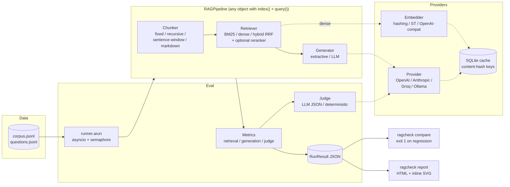

# ragcheck

[](https://github.com/Josh2106/ragcheck/actions/workflows/ci.yml)


[](LICENSE)

**Benchmark and regression-test RAG pipelines - like `pytest` + a CI gate, for retrieval-augmented generation.**

You changed the chunk size, swapped the embedding model, or tweaked the prompt. Did
retrieval get better or worse? `ragcheck` answers that with numbers, and fails your CI
build when a change makes things worse:

```console
$ ragcheck compare baseline.json current.json --fail-on "recall@5<-0.02" --fail-on "ndcg@5<-0.02"
| metric   | baseline | current |   delta | delta % | status |
| recall@5 |   0.9750 |  0.9750 | +0.0000 |   +0.0% | ok     |
| mrr      |   0.9750 |  0.9000 | -0.0750 |   -7.7% | ok     |
| ndcg@5   |   0.9622 |  0.9057 | -0.0565 |   -5.9% | FAIL   |
regression: ndcg@5: ndcg@5<-0.02
$ echo $?
1
```

(Real output, trimmed: switching the quickstart pipeline from hybrid to dense-only retrieval.)

## Features

- **Typed core** - immutable Pydantic v2 models (`Document`, `Chunk`, `EvalCase`, `EvalResult`, ...)
  and `Protocol` interfaces (`Chunker`, `Embedder`, `Retriever`, `Generator`, `Judge`), so any
  component can be swapped for your own without inheritance.
- **Chunkers** - fixed-size (chars or tokens; tiktoken if installed, regex fallback otherwise),
  recursive-by-separators, sentence-window, Markdown-header-aware. Every chunk satisfies
  `chunk.text == doc.text[chunk.start:chunk.end]`, verified by Hypothesis property tests.
- **Retrievers** - Okapi BM25 implemented from scratch (tested against hand-computed scores),
  dense cosine search over NumPy, hybrid via reciprocal rank fusion, and a reranking hook
  (cross-encoder adapter or any `fn(query, text) -> score`). The vector index is pluggable.
- **Embedders** - a deterministic hashing embedder for offline tests/CI, a
  sentence-transformers adapter (optional extra), and an OpenAI-compatible HTTP embedder that
  works with OpenAI, Ollama and other compatible gateways via `base_url`.
- **LLM providers** - OpenAI, Anthropic, Groq and Ollama behind one `Provider` protocol, with
  retries/backoff (429, 5xx, `Retry-After`). Tests exercise them only through mocked HTTP.
- **Metrics** - Recall@k, Precision@k, MRR, nDCG@k, hit rate; exact match, token F1, ROUGE-L,
  semantic similarity; and RAGAS-style faithfulness, answer relevance, context precision and
  context recall via an LLM judge with strict JSON parsing - plus a `DeterministicJudge` for CI.
- **Runner** - `ragcheck.run(pipeline, dataset, metrics)` with bounded async concurrency,
  per-case error capture, rich progress bars, and a content-addressed SQLite cache for
  embeddings and LLM calls (re-running an unchanged experiment costs zero API calls).
- **CLI** - `run` (YAML config), `compare` (the CI gate), `report` (self-contained HTML with
  inline SVG charts, no JS, no CDN), `grid` (chunk size x retriever sweeps), `metrics`.

## Architecture



More detail in [ARCHITECTURE.md](ARCHITECTURE.md).

## Install

Not on PyPI yet. Install from source:

```bash
git clone https://github.com/Josh2106/ragcheck && cd ragcheck
python -m venv .venv && source .venv/bin/activate   # Windows: .venv\Scripts\activate
pip install -e ".[dev]"            # add ,tiktoken or ,sentence-transformers for the extras
```

Python 3.11+. Core dependencies: pydantic, numpy, httpx, typer, rich, pyyaml.

## Quickstart (offline, no API key)

The repo bundles a small **synthetic** corpus: 30 documentation pages for *Larkspur*, a
fictional task-queue product, and 20 labelled questions. The quickstart uses the hashing
embedder, an extractive generator and the deterministic judge, so it needs no network:

```console
$ ragcheck run examples/quickstart.yaml --html results/quickstart.html
evaluating larkspur-sample ------------------------------ 20/20 0:00:00
| metric              |  mean |   std |   min |   max |  n |
| recall@5            | 0.975 | 0.109 | 0.500 | 1.000 | 20 |
| precision@5         | 0.210 | 0.044 | 0.200 | 0.400 | 20 |
| mrr                 | 0.975 | 0.109 | 0.500 | 1.000 | 20 |
| ndcg@5              | 0.962 | 0.113 | 0.613 | 1.000 | 20 |
| hit_rate@5          | 1.000 | 0.000 | 1.000 | 1.000 | 20 |
| exact_match         | 0.100 | 0.300 | 0.000 | 1.000 | 20 |
| token_f1            | 0.461 | 0.338 | 0.000 | 1.000 | 20 |
| rouge_l             | 0.437 | 0.336 | 0.000 | 1.000 | 20 |
| semantic_similarity | 0.517 | 0.335 | 0.000 | 1.000 | 20 |
| faithfulness        | 1.000 | 0.000 | 1.000 | 1.000 | 20 |
| answer_relevance    | 0.404 | 0.084 | 0.234 | 0.550 | 20 |
| context_precision   | 0.913 | 0.227 | 0.000 | 1.000 | 20 |
| context_recall      | 0.950 | 0.218 | 0.000 | 1.000 | 20 |
results written to results/quickstart.json
report written to results/quickstart.html
20 cases, 59 chunks, 0.12s total
```

The whole command takes about **0.7 s wall-clock** on a laptop (Windows 11, Python 3.12,
including interpreter start-up). Faithfulness is trivially 1.0 here because the extractive
generator only ever copies sentences out of the retrieved context - with an LLM generator it
becomes informative.

### Python API

```python
import ragcheck
from ragcheck.chunkers import MarkdownHeaderChunker
from ragcheck.embedders import HashingEmbedder
from ragcheck.generators import ExtractiveGenerator
from ragcheck.judges import DeterministicJudge
from ragcheck.metrics import build_metrics
from ragcheck.retrievers import BM25Retriever, DenseRetriever, HybridRetriever

dataset = ragcheck.load_sample()          # or ragcheck.load_dataset("path/to/dir")
embedder = HashingEmbedder(dim=1024)      # swap for OpenAICompatibleEmbedder(...) in real runs

pipeline = ragcheck.RAGPipeline(
    chunker=MarkdownHeaderChunker(max_chunk_size=500),
    retriever=HybridRetriever([BM25Retriever(), DenseRetriever(embedder)]),
    generator=ExtractiveGenerator(),
    top_k=5,
)
metrics = build_metrics(
    ["recall@5", "mrr", "ndcg@5", "token_f1", "faithfulness", "context_recall"],
    embedder=embedder,
    judge=DeterministicJudge(),
)
result = ragcheck.run(pipeline, dataset, metrics, concurrency=8)
print(result.to_markdown())
result.save("results/markdown-hybrid.json")
```

Bring your own pipeline: anything with `index(documents)` and
`async query(question, query_id) -> (RetrievedContext, Answer)` can be evaluated.

## Regression gate in CI

```bash
ragcheck run examples/quickstart.yaml -o results/current.json
ragcheck compare examples/baseline.json results/current.json \
  --fail-on "recall@5<-0.02" --fail-on "ndcg@5<-0.02" --fail-on "token_f1<-5%"
```

Rule syntax: `METRIC OP VALUE[%]`, where the left-hand side is `current - baseline`
(absolute) or, with `%`, the relative change. `OP` is `<`, `<=`, `>`, `>=`. `*` applies a
rule to every shared metric; run stats such as `latency_ms_mean>50` also work. A rule that
names a metric missing from either run fails - a silently dropped metric should not pass the
gate. Exit codes: `0` pass, `1` regression, `2` usage error. `--json` gives machine-readable
output. The `regression-gate` job in [.github/workflows/ci.yml](.github/workflows/ci.yml)
shows the full setup.

`ragcheck report results.json --html out.html [--baseline baseline.json]` renders a single
self-contained HTML page (bar chart, per-metric histograms, per-case table with relevant
documents highlighted) that you can attach as a CI artifact.

## Metrics

Relevance is binary at the **document** level: retrieved chunks are collapsed to their
document ids in rank order (first occurrence wins). `R` = relevant documents,
`d_1..d_k` = top-k retrieved documents. Metrics return `None` when not applicable (e.g. no
labels) and `None`s are excluded from means rather than counted as 0.

| Metric | Kind | Definition |
|---|---|---|
| `recall@k` | retrieval | \|R ∩ {d_1..d_k}\| / \|R\| |
| `precision@k` | retrieval | \|R ∩ {d_1..d_k}\| / k |
| `hit_rate@k` | retrieval | 1 if R ∩ {d_1..d_k} ≠ ∅ else 0 |
| `mrr[@k]` | retrieval | 1 / rank of the first relevant document (0 if none) |
| `ndcg@k` | retrieval | DCG_k / IDCG_k, DCG_k = Σ_i 1[d_i ∈ R] / log2(i + 1) |
| `exact_match` | generation | normalised answer == normalised reference (SQuAD normalisation) |
| `token_f1` | generation | harmonic mean of token precision/recall over the multiset overlap |
| `rouge_l` | generation | F_β with P = LCS/\|answer\|, R = LCS/\|reference\| (Lin, 2004), β = 1 |
| `semantic_similarity` | generation | cos(E(answer), E(reference)), clipped to [0, 1] |
| `faithfulness` | judge | supported claims / claims extracted from the answer |
| `answer_relevance` | judge | mean_i cos(E(q), E(q_i)) over n questions q_i generated from the answer; 0 if noncommittal |
| `context_precision[@k]` | judge | Σ_k (P@k · v_k) / Σ_k v_k, v_k = "chunk k was useful for the reference answer" |
| `context_recall` | judge | reference-answer sentences attributable to the context / all sentences |

The judge metrics follow **RAGAS** (Es, James, Espinosa-Anke and Schockaert, *RAGAS:
Automated Evaluation of Retrieval Augmented Generation*, EACL 2024 demos,
[arXiv:2309.15217](https://arxiv.org/abs/2309.15217)) and the context precision/recall
definitions documented by the `ragas` library. The judge only produces verdicts (JSON,
validated in Pydantic strict mode, one repair attempt on malformed output); the arithmetic
lives in plain, unit-tested Python. See [docs/metrics.md](docs/metrics.md).

## Experiments: chunk size x retriever

`ragcheck grid examples/grid.yaml --markdown results/grid.md` sweeps every combination and
prints a comparison table. These are the **real numbers** from running it on the bundled
**synthetic** corpus (recursive chunker, no overlap, hashing embedder, extractive generator,
deterministic judge, top-5; best per column in bold):

| chunker | size | retriever | chunks | recall@1 | recall@5 | mrr | ndcg@5 | token_f1 | faithfulness | context_recall | time (s) |
|---|---:|---|---:|---:|---:|---:|---:|---:|---:|---:|---:|
| recursive | 200 | bm25 | 101 | 0.900 | **0.975** | 0.975 | 0.962 | **0.501** | **1.000** | **1.000** | 0.01 |
| recursive | 200 | dense | 101 | 0.900 | 0.925 | 0.950 | 0.931 | 0.457 | **1.000** | 0.950 | 0.04 |
| recursive | 200 | hybrid | 101 | 0.900 | **0.975** | 0.975 | 0.962 | **0.501** | **1.000** | **1.000** | 0.04 |
| recursive | 400 | bm25 | 57 | 0.900 | **0.975** | 0.975 | 0.962 | **0.501** | **1.000** | **1.000** | 0.02 |
| recursive | 400 | dense | 57 | 0.800 | **0.975** | 0.908 | 0.912 | 0.461 | **1.000** | 0.950 | 0.07 |
| recursive | 400 | hybrid | 57 | 0.900 | **0.975** | 0.975 | 0.962 | 0.461 | **1.000** | 0.950 | 0.05 |
| recursive | 800 | bm25 | 30 | **0.950** | **0.975** | **1.000** | **0.981** | **0.501** | **1.000** | **1.000** | 0.02 |
| recursive | 800 | dense | 30 | 0.800 | **0.975** | 0.925 | 0.921 | 0.495 | **1.000** | **1.000** | 0.04 |
| recursive | 800 | hybrid | 30 | 0.900 | **0.975** | 0.975 | 0.958 | **0.501** | **1.000** | **1.000** | 0.05 |

How to read this honestly:

- The corpus is tiny (30 docs, 20 questions) and synthetic, and the questions reuse the
  documents' wording, so lexical BM25 is near the ceiling. Differences of 0.05 are one
  question. **Do not generalise these numbers to real data.**
- "dense" here is the *hashing* embedder - a lexical stand-in that keeps CI deterministic,
  not a semantic model. It losing to BM25 says nothing about real embedding models; rerun the
  grid with `embedder: {type: openai, ...}` or `sentence_transformers` for that.
- The point of the table is the workflow: one command gives you a comparable, versionable
  matrix for *your* corpus.

## Configuration

```yaml
name: my-experiment
dataset: path/to/dir            # corpus.jsonl + questions.jsonl, or builtin:sample
chunker:   {type: markdown, max_chunk_size: 800}       # fixed | recursive | sentence_window | markdown
embedder:  {type: openai, model: text-embedding-3-small}  # hashing | openai | ollama | sentence_transformers
retriever: {type: hybrid, rrf_k: 60, fetch_k: 20}      # bm25 | dense | hybrid
reranker:  {type: cross_encoder, model_name: cross-encoder/ms-marco-MiniLM-L-6-v2}  # optional
generator: {type: llm, provider: anthropic, model: <model-id>}  # extractive | llm
judge:     {type: llm, provider: openai, model: <model-id>}     # deterministic | llm
cache: .ragcheck_cache/cache.sqlite                    # embeddings + LLM calls, keyed by content hash
metrics: [recall@5, ndcg@5, token_f1, faithfulness, context_recall]
top_k: 5
concurrency: 8
output: results/my-experiment.json
```

API keys come from environment variables (`OPENAI_API_KEY`, `ANTHROPIC_API_KEY`,
`GROQ_API_KEY`) and are never written to results or cache keys. Unknown options are rejected
with a clear error. See [docs/configuration.md](docs/configuration.md) and `examples/`.

Dataset format (JSONL, one object per line):

```json
{"id": "install", "title": "Installation", "text": "Larkspur runs on Linux ..."}
{"id": "q01", "question": "What port does the server listen on?", "answer": "Port 7420.", "relevant_doc_ids": ["install"]}
```

## Development

```bash
pip install -e ".[dev]"
pytest --cov=ragcheck      # 178 tests, 99% line+branch coverage, fully offline
ruff check src tests && ruff format --check src tests
mypy                       # --strict, src/
python -m build            # sdist + wheel
```

No test touches the network: real providers are tested against `httpx.MockTransport` and
`respx`, sentence-transformers against an injected fake module, and Hypothesis checks the
chunker invariants (no content lost, size limits respected) and RRF properties (order
independence, score definition, unanimous winner first).

## Roadmap

- [ ] Publish to PyPI (release workflow with trusted publishing is ready)
- [ ] Graded relevance labels for nDCG; chunk-level (not only document-level) relevance
- [ ] FAISS / Qdrant `VectorIndex` adapters
- [ ] Bootstrap confidence intervals and paired significance tests in `compare`
- [ ] Synthetic question generation from a corpus (with human review)
- [ ] Token/cost accounting per run from provider usage fields
- [ ] Streaming per-case results to JSONL for very large datasets

## Limitations

- The bundled corpus and all numbers above are synthetic and small; they demonstrate the
  tool, not any retrieval method.
- `DeterministicJudge` is a lexical-overlap heuristic for CI smoke tests. It cannot detect
  paraphrased support or subtle hallucinations; use an LLM judge for real evaluation.
- The real providers are tested only against mocked HTTP responses shaped like the public
  APIs; they have not been run against the live services in this repository's CI.
- Retrieval is synchronous inside the async runner, so remote embedding calls at query time
  are not parallelised (LLM generation and judging are).
- LLM-judge scores vary with the judge model and prompt; compare runs that use the same judge.

## License

MIT - see [LICENSE](LICENSE). Contributions welcome, see [CONTRIBUTING.md](CONTRIBUTING.md).
